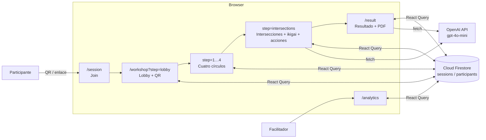

<div align="center">

<!-- TODO: crear docs/banner-dark.png y docs/banner-light.png (1280x640) con la paleta de noeosorio.com (fondo #18181b, acento #bef264 → #10b981) y descomentar
<picture>
  <source media="(prefers-color-scheme: dark)" srcset="docs/banner-dark.png">
  
</picture>
-->

# 🌸 Ikigapp

**Talleres de ikigai en vivo: cada participante explora sus cuatro círculos y sale con su propósito y una acción concreta.**


[Quickstart](#-quickstart) · [Configuración](#️-configuración) · [Reportar bug](../../issues)

</div>

*Ikigai* (生き甲斐) es la intersección de lo que amas, en lo que eres bueno, lo que el mundo necesita y por lo que te pueden pagar. Ikigapp convierte ese ejercicio en un flujo guiado para talleres: el facilitador crea una sesión, los participantes entran con un QR, responden paso a paso y la IA les propone sus intersecciones. Al final cada quien redacta su frase de ikigai, se compromete con acciones y descarga su resultado en PDF.

## ✨ Features

| | Feature | Detalle |
|---|---|---|
| 🧑‍🤝‍🧑 | **Sesiones en vivo** | Crea o únete a una sesión; el lobby muestra un QR y la lista de participantes en tiempo real (Firestore `onSnapshot`). |
| 🍂 | **Cuatro círculos por estación** | Cada categoría tiene su propia paleta: primavera, verano, otoño e invierno. |
| 🤖 | **Intersecciones con IA** | `gpt-4o-mini` sugiere pasión, misión, profesión y vocación a partir de tus respuestas, y genera un resumen de tu ikigai. |
| 🎯 | **Propósito + acciones** | Redactas tu frase de ikigai y al menos una acción concreta para validarlo. |
| 📄 | **Resultado para compartir** | Vista `/result` con enlace copiable y descarga en PDF (jsPDF). |
| 💾 | **Borradores que sobreviven** | Las respuestas se guardan en `localStorage` y en Firestore; puedes cerrar la pestaña y retomar. |
| 📊 | **Analytics del taller** | `/analytics` muestra tasa de finalización y promedios por círculo, con detalle por sesión y archivado. |

## 🖼️ Demo

<!-- TODO: agregar docs/demo.gif (Join → Lobby con QR → 4 círculos → Intersecciones → Resultado) -->
Demo próximamente.

## 🚀 Quickstart

### Requisitos

- Node.js 20.19+ o 22.12+ (lo que pide Vite 7) y npm
- Un proyecto de Firebase con **Cloud Firestore** habilitado
- Una API key de OpenAI (para las intersecciones y el resumen con IA)

```bash
git clone https://github.com/NoeOsorio/ikigapp.git
cd ikigapp
npm install
cp .env.example .env.local   # rellena tus valores de Firebase y OpenAI
npm run dev                  # http://localhost:5173
```

| Script | Qué hace |
|---|---|
| `npm run dev` | Servidor de desarrollo de Vite con HMR |
| `npm run build` | Chequeo de tipos (`tsc -b`) + build de producción |
| `npm run preview` | Sirve el build localmente |
| `npm run lint` | ESLint en todo el proyecto |

## ⚙️ Configuración

Copia [`.env.example`](.env.example) a `.env.local`. Los valores de Firebase están en *Firebase console → Project Settings → Your apps → SDK setup*.

| Variable | Para qué sirve |
|---|---|
| `VITE_FIREBASE_API_KEY` | Config web de Firebase |
| `VITE_FIREBASE_AUTH_DOMAIN` | Config web de Firebase |
| `VITE_FIREBASE_PROJECT_ID` | Proyecto donde viven las colecciones `sessions` y sus participantes |
| `VITE_FIREBASE_STORAGE_BUCKET` | Config web de Firebase |
| `VITE_FIREBASE_MESSAGING_SENDER_ID` | Config web de Firebase |
| `VITE_FIREBASE_APP_ID` | Config web de Firebase |
| `VITE_OPENAI_API_KEY` | Llamadas a OpenAI (`gpt-4o-mini`) para intersecciones y resumen |

> [!WARNING]
> Las variables `VITE_*` se incrustan en el bundle del navegador. La llamada a OpenAI se hace desde el cliente, así que **tu API key queda visible** para cualquiera que abra la app. Úsala solo en local o con una key restringida y con límite de gasto; en producción mueve la llamada a un servidor o Cloud Function.

> [!IMPORTANT]
> La app no tiene autenticación: la seguridad de los datos depende de las **reglas de Firestore** de tu proyecto. Configúralas antes de desplegar (por ejemplo, restringiendo la lectura global que usa `/analytics`).

## 🏗️ Arquitectura

SPA de React sin servidor propio: el estado de navegación vive en la URL (`nuqs`), los datos del taller en Firestore y la IA se llama directamente desde el navegador.



<details>
<summary>Stack completo</summary>

React 19 · TypeScript 5.9 · Vite 7 · Tailwind CSS v4 · React Router 7 · nuqs (estado en query params) · TanStack Query 5 · Firebase 12 (Firestore) · framer-motion · lucide-react · qrcode.react · jsPDF · nanoid

</details>

## 📁 Estructura

<details>
<summary>Ver estructura</summary>

```text
src/
├── App.tsx           # Rutas: /, /session, /workshop, /result, /analytics
├── pages/            # Join, Lobby, CategoryStep, IntersectionsStep, Snapshot, Analytics, About
├── components/       # Diagrama de Venn, QR, fondos animados, layout y nav
├── services/         # Firestore (sessions, participants, analytics) y OpenAI
├── hooks/            # React Query: useSession, useParticipant(s), useAiIkigai
├── models/           # Tipos y converters de Firestore
├── context/          # Estado del formulario del ikigai
├── lib/              # nuqs, rutas, PDF, storage local
├── constants/        # Las cuatro categorías y sus estaciones
└── firebase/         # Inicialización de Firebase
```

</details>

## 🤝 Contribuir

Issues y pull requests son bienvenidos. Antes de abrir un PR, verifica que `npm run lint` y `npm run build` pasen.

## 📄 Licencia

Distribuido bajo licencia MIT. Ver [`LICENSE`](LICENSE).

---

<div align="center">

*El ikigai no se "descubre" un día y ya; se refina con autoobservación y pequeños experimentos en la vida real.*

Hecho con ☕ por [Noé Osorio](https://noeosorio.com) y colaboradores · [business@noeosorio.com](mailto:business@noeosorio.com)

</div>
